<p align="center">
  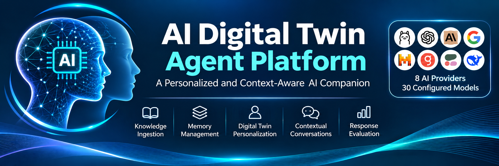
</p>

# AI Digital Twin Agent Platform

<p align="center">
  <strong>A Multi-Provider, Multi-Model Personalized AI Digital Twin</strong>
</p>

**Version:** 1.0.0  
**Project Status:** Development Complete  
**Language:** Python 3.11+  
**Frontend:** Streamlit  
**Architecture:** Modular Layered Architecture  
**Persistence:** JSON-based Storage

---

# Table of Contents

1. Project Overview
2. Objectives
3. Features
4. Technology Stack
5. AI Providers and Models
6. System Architecture
7. Project Structure
8. Application Workflow
9. Development Roadmap
10. Installation and Configuration
11. API and Service Overview
12. Knowledge Management
13. Memory Management
14. Digital Twin Conversations
15. Personalization and Intelligence
16. Response Quality and Consistency
17. Data Storage
18. Testing and Validation
19. User Guide
20. Troubleshooting
21. Security
22. Project Notes and Future Enhancements
23. Frequently Asked Questions
24. Interview Questions and Answers
25. Resume Highlights
26. Contributing
27. Code of Conduct
28. Changelog and Release Notes
29. Screenshots
30. License and Author

---

# 1. Project Overview

The AI Digital Twin Agent Platform is a Python-based Generative AI application designed to create an intelligent, personalized digital representation of a user.

It combines knowledge ingestion, intelligent memory, contextual retrieval, multi-turn conversations, personalization, and multiple AI providers into a unified platform.

The Digital Twin can use stored knowledge, memories, personal context, and conversation history to generate relevant and personalized responses.

The platform follows SOLID principles, separation of concerns, dependency inversion, interface-based design, and modular architecture.

# 2. Project Objectives

- Build a personalized AI Digital Twin.
- Support multiple AI providers and models.
- Ingest and retrieve personal knowledge.
- Maintain short-term and long-term memories.
- Support episodic and semantic memories.
- Maintain persistent multi-turn conversations.
- Generate context-aware responses.
- Personalize responses using user preferences and expertise.
- Evaluate basic response quality and consistency.
- Provide a modular and extensible application architecture.

# 3. Features

## Multi-Provider AI Integration
- 8 AI providers.
- 30 configured models.
- Provider abstraction.
- ProviderFactory.
- Provider registration.
- Dynamic provider and model selection.

## Knowledge Management
- PDF, DOCX, TXT, Markdown, and CSV ingestion.
- Document extraction.
- Text chunking.
- Metadata handling.
- JSON persistence.
- Knowledge retrieval.

## Memory Management
- Short-term memory.
- Long-term memory.
- Episodic memory.
- Semantic memory.
- Memory search and retrieval.
- Memory updates and deletion.
- Short-term to long-term memory consolidation.

## Digital Twin Interaction
- Conversation creation.
- Multi-turn interaction.
- Persistent conversation history.
- Conversation archival.
- Conversation deletion.
- Context-aware response generation.

## Personalization
- Personal profile context.
- Preference awareness.
- Expertise awareness.
- Personalized prompt construction.

## Response Evaluation
- Empty-response detection.
- Short-response detection.
- Repetition detection.
- Lexical similarity evaluation.
- Quality scores and consistency warnings.

# 4. Technology Stack

| Category | Technology |
|---|---|
| Language | Python |
| Version | Python 3.11+ |
| Frontend | Streamlit |
| AI Integration | Multiple LLM providers |
| Local LLM | Ollama |
| Cloud LLMs | OpenAI, Anthropic, Gemini, Mistral, Groq, Cohere, DeepSeek |
| Persistence | JSON |
| Testing | PyTest |
| Version Control | Git, GitHub |
| Architecture | Layered Architecture |

# 5. AI Providers and Models

The platform supports eight providers and 30 configured models.

## Ollama – 9 Models
1. qwen2.5:1.5b
2. gemma2:2b
3. gemma3:4b
4. mistral:latest
5. phi3:latest
6. qwen3:latest
7. llama3.1:latest
8. llama3:8b
9. deepseek-coder:latest

Preferred default local model: `qwen2.5:1.5b`.

## OpenAI – 3 Models
- gpt-5-mini
- gpt-4o
- gpt-4o-mini

## Anthropic – 3 Models
- claude-sonnet-4-5
- claude-haiku-4-5
- claude-opus-4-1

## Gemini – 3 Models
- gemini-3.6-flash
- gemini-2.5-flash
- gemini-2.5-pro

## Mistral – 3 Models
- mistral-medium-latest
- mistral-large-latest
- mistral-small-latest

## Groq – 3 Models
- llama-3.3-70b-versatile
- llama-3.1-8b-instant
- mixtral-8x7b-32768

## Cohere – 3 Models
- command-a-03-2025
- command-r-plus
- command-r

## DeepSeek – 3 Models
- deepseek-chat
- deepseek-reasoner
- deepseek-v4-flash

**Total: 8 Providers | 30 Configured Models**

# 6. System Architecture

The application follows a four-layer architecture.

```text
AI Digital Twin Agent Platform
│
├── Presentation Layer
│   └── Streamlit UI
│
├── Application Layer
│   ├── Agents
│   ├── Services
│   ├── Intelligence
│   ├── Memory Management
│   ├── Knowledge Management
│   ├── Conversation Management
│   ├── Personalization
│   └── Response Evaluation
│
├── Domain Layer
│   ├── Entities
│   ├── Interfaces
│   └── Business Rules
│
└── Infrastructure Layer
    ├── AI Providers
    ├── Provider Registry
    ├── JSON Repositories
    └── Persistence
```

## Architectural Principles

- Single Responsibility Principle.
- Open/Closed Principle.
- Liskov Substitution Principle.
- Interface Segregation Principle.
- Dependency Inversion Principle.
- Separation of Concerns.
- Dependency Injection.
- Modular design.

# 7. Project Structure

The application is organized around these architectural responsibilities:

```text
AI-Digital-Twin-Agent-Platform/
│
├── app/
│   ├── application/
│   │   ├── agents/
│   │   ├── services/
│   │   └── container.py
│   │
│   ├── domain/
│   │   ├── entities/
│   │   └── interfaces/
│   │
│   ├── infrastructure/
│   │   ├── persistence/
│   │   └── providers/
│   │
│   └── presentation/
│       └── pages/
│
├── data/
│   ├── knowledge/
│   ├── memory/
│   └── conversations/
│
├── tests/
├── config/
├── requirements.txt
├── .env.example
└── README.md
```

This is a logical architecture overview. Refer to the actual repository tree for the complete file-level structure.

# 8. Application Workflow

```text
User
  |
  v
Streamlit Application
  |
  v
Provider and Model Selection
  |
  v
Knowledge Ingestion and Retrieval
  |
  v
Memory Management
  |
  v
Intelligence Context Builder
  |
  v
Personalization
  |
  v
Digital Twin Interaction
  |
  v
Selected AI Provider
  |
  v
Response Quality Evaluation
  |
  v
Response Consistency Evaluation
  |
  v
Personalized AI Response
```

# 9. Development Roadmap

The project was developed in five major phases.

| Phase | Name | Status |
|---|---|---|
| 0 | General Foundation | Complete |
| 1 | Knowledge Ingestion Process | Complete |
| 2 | Intelligence & Memory Process | Complete |
| 3 | Digital Twin Interaction Process | Complete |
| 4 | Validation & Advanced Twin Intelligence | Complete |

## Development Cycle

Each phase followed:

**PLAN → DESIGN → IMPLEMENT → TEST → FIX → STABILIZE**

## Phase 0 – General Foundation
- Modular architecture.
- SOLID principles.
- Provider abstraction.
- ProviderFactory and registry.
- Dependency injection.
- Configuration and logging foundation.

## Phase 1 – Knowledge Ingestion
- Document validation.
- Document extraction.
- Chunking and metadata.
- JSON storage.
- Knowledge retrieval.
- Ingestion recovery.

## Phase 2 – Intelligence and Memory
- Memory entities and repositories.
- Four memory types.
- Memory search and consolidation.
- Intelligence context building.
- Intelligence Service.
- Memory Agent.

## Phase 3 – Digital Twin Interaction
- Conversation entities.
- JSON conversation repository.
- Conversation Service.
- Digital Twin Interaction Agent.
- Multi-turn conversation support.

## Phase 4 – Validation and Advanced Twin Intelligence
- Advanced context intelligence.
- Advanced memory retrieval.
- Digital Twin personalization.
- Response quality evaluation.
- Response consistency evaluation.
- Integrated application validation.
- Final stabilization.

# 10. Installation and Configuration

## Prerequisites

- Python 3.11 or later.
- Git.
- Ollama for local model usage.
- API credentials for cloud providers you want to use.

## Clone Repository

```bash
git clone <YOUR_GITHUB_REPOSITORY_URL>
cd <YOUR_PROJECT_DIRECTORY>
```

## Create Virtual Environment

```bash
python -m venv venv
```

Windows:

```bash
venv\Scripts\activate
```

## Install Dependencies

```bash
pip install -r requirements.txt
```

## Environment Configuration

Create a `.env` file based on `.env.example`, if provided.

Configure:
- Provider API credentials.
- Ollama base URL.
- Default provider.
- Default model.
- Application-specific settings.

Never commit secrets or API keys.

## Ollama Setup

```bash
ollama pull qwen2.5:1.5b
ollama serve
```

## Start Application

```bash
streamlit run <YOUR_STREAMLIT_ENTRYPOINT.py>
```

Use the actual Streamlit entry point in your repository.

# 11. API and Service Overview

The following application services form the core of the platform.

| Service | Responsibility |
|---|---|
| AIService | AI provider communication |
| ProviderFactory | Provider creation |
| ProviderModelService | Provider/model selection |
| KnowledgeIngestionService | Document ingestion |
| KnowledgeRetrievalService | Knowledge retrieval |
| MemoryService | Memory management |
| IntelligenceContextBuilder | Context construction |
| IntelligenceService | AI response generation |
| ConversationService | Conversation management |
| DigitalTwinPersonalizationService | Personalization context |
| ResponseQualityService | Response quality evaluation |
| ResponseConsistencyService | Repetition and similarity evaluation |

## Main Agents

- KnowledgeAgent.
- MemoryAgent.
- DigitalTwinInteractionAgent.

# 12. Knowledge Management

Knowledge ingestion supports:

- PDF.
- DOCX.
- TXT.
- Markdown.
- CSV.

Processing workflow:

1. Upload document.
2. Validate document.
3. Extract content.
4. Split content into chunks.
5. Attach metadata.
6. Persist knowledge.
7. Retrieve relevant content.

# 13. Memory Management

The platform supports four memory types.

| Memory Type | Purpose |
|---|---|
| SHORT_TERM | Temporary information |
| LONG_TERM | Retained information |
| EPISODIC | Experiences and events |
| SEMANTIC | Facts and concepts |

Memory operations:

- Create.
- Retrieve.
- Search.
- Update.
- Delete.
- Filter.
- Consolidate.

Short-term memory consolidation creates long-term memories and removes the original short-term records after successful processing.

# 14. Digital Twin Conversations

Conversation management includes:

- Conversation creation.
- User messages.
- Assistant messages.
- Conversation history.
- Multi-turn context.
- Archiving.
- Deletion.
- JSON persistence.

The interaction agent combines recent conversation history with knowledge, memory, and the current query.

# 15. Personalization and Intelligence

The Digital Twin uses available stored information to construct personalized context.

Personalization categories:

- Profile.
- Preferences.
- Expertise.

The Intelligence Service combines:

1. Current query.
2. Knowledge context.
3. Memory context.
4. Conversation context.
5. Personalization context.

The selected AI provider generates the response.

Personalization depends on the information available in stored memories. It does not guarantee complete or accurate personal-profile extraction.

# 16. Response Quality and Consistency

## Response Quality

Checks:
- Empty response.
- Short response.
- Repeated sentences.

Returns:
- Validity status.
- Quality score.
- Issues.
- Suggestions.

## Response Consistency

Checks:
- Similarity with previous assistant responses.
- Potential repetition.

Returns:
- Consistency status.
- Similarity score.
- Repeated responses.
- Warnings.

These are lightweight heuristic checks, not comprehensive factual verification or semantic contradiction detection.

# 17. Data Storage

The application uses JSON-based persistence.

Storage responsibilities include:

- Knowledge records.
- Knowledge chunks.
- Memory records.
- Conversation records.
- Conversation messages.

The application does not require a relational database for its current storage design.

# 18. Testing and Validation

PyTest is used as the testing framework.

The development process includes:
- Service-level testing.
- Repository testing.
- Agent testing.
- Integrated application validation.
- Restart and persistence verification.

The integrated application validation for the completed development roadmap was confirmed by the project owner.

Individual test counts and coverage percentages should be added only after checking the final test results.

# 19. User Guide

1. Start the Streamlit application.
2. Select an AI provider.
3. Select an available model.
4. Upload knowledge documents.
5. Search ingested knowledge.
6. Save personal memories.
7. Manage memory categories.
8. Create a Digital Twin conversation.
9. Interact through multiple turns.
10. Review personalized AI responses.

# 20. Troubleshooting

| Problem | Suggested action |
|---|---|
| Ollama connection failure | Check that Ollama is running and the configured URL is correct. |
| Model unavailable | Pull the model using Ollama or verify the provider's configured model list. |
| Cloud provider error | Verify API credentials and provider configuration. |
| Document ingestion failure | Check file type, file size, and extraction dependencies. |
| Invalid JSON storage | Preserve a backup before attempting recovery. |
| Conversation loading failure | Check conversation JSON structure and storage path. |
| Missing Python package | Install dependencies from requirements.txt. |
| Streamlit startup error | Check the entry point, imports, and environment. |

# 21. Security

Security considerations:

- Keep API keys in environment variables.
- Never commit `.env` files.
- Use `.gitignore` for secrets and sensitive data.
- Protect personal knowledge and memory files.
- Review data before sharing repository backups.
- Apply appropriate access controls when deploying beyond a local environment.

# 22. Project Notes and Future Enhancements

The v1.0.0 implementation uses JSON-based storage and lexical retrieval techniques.

Potential future improvements:

- Embedding-based semantic memory retrieval.
- Advanced semantic relevance scoring.
- Factual contradiction detection.
- More sophisticated memory consolidation.
- Advanced profile extraction.
- Additional integrations.
- Production deployment and monitoring.

These are future possibilities, not features claimed as completed in v1.0.0.

# 23. Frequently Asked Questions

**Q1. What is an AI Digital Twin?**

An AI Digital Twin is an AI-powered representation of a user that can use stored knowledge, memories, preferences, and conversation context to provide personalized responses.

**Q2. How many AI providers are supported?**

Eight providers.

**Q3. How many models are configured?**

Thirty models.

**Q4. Does the application support local models?**

Yes. Ollama is supported.

**Q5. Does the application require MySQL?**

No. The current platform uses JSON-based persistence.

**Q6. What memory types are available?**

Short-term, long-term, episodic, and semantic.

**Q7. Does it support multi-turn conversations?**

Yes. Conversation history is persisted and used for contextual interaction.

**Q8. Can the Digital Twin personalize responses?**

Yes. It uses available stored profile, preference, and expertise memories.

# 24. Interview Questions and Answers

**Q1. Why did you use layered architecture?**

To separate responsibilities, improve maintainability, and make the platform extensible.

**Q2. How did you implement multiple AI providers?**

Using provider abstractions, a ProviderFactory, and provider registration.

**Q3. Why use dependency injection?**

To reduce tight coupling and allow services to depend on abstractions and injected dependencies.

**Q4. How is knowledge managed?**

Documents are validated, extracted, chunked, persisted, and retrieved through dedicated services.

**Q5. How does memory consolidation work?**

Short-term memories are converted into long-term memory records and the original short-term records are deleted after successful processing.

**Q6. How does the Digital Twin maintain context?**

It combines relevant knowledge, stored memories, and recent conversation history.

**Q7. How is personalization implemented?**

A dedicated personalization service categorizes available memories into profile, preference, and expertise context.

**Q8. How is response quality evaluated?**

Through deterministic checks for empty responses, short responses, and repeated sentences.

**Q9. How is response consistency evaluated?**

By comparing the new response with previous assistant responses using lexical similarity.

**Q10. Why use JSON storage?**

It provides a lightweight persistence mechanism without requiring a database server.

# 25. Resume Highlights

**AI Digital Twin Agent Platform | Python | Streamlit | Generative AI**

- Developed a multi-provider, multi-model AI Digital Twin platform supporting 8 AI providers and 30 configured models.
- Designed a modular, layered architecture following SOLID principles and dependency injection.
- Implemented document ingestion, chunking, metadata management, and knowledge retrieval.
- Built persistent memory management supporting short-term, long-term, episodic, and semantic memory.
- Developed multi-turn Digital Twin conversations with persistent JSON-based history.
- Implemented personalization using stored profile, preference, and expertise context.
- Integrated response quality and consistency evaluation services.
- Built a unified Streamlit application integrating knowledge, memory, intelligence, and conversation workflows.

# 26. Contributing

Contributions should preserve the existing architectural boundaries and design principles.

Recommended workflow:

1. Fork the repository.
2. Create a feature branch.
3. Follow existing coding conventions.
4. Implement changes within the appropriate layer.
5. Run relevant tests.
6. Submit a pull request with a clear description.

# 27. Code of Conduct

Contributors are expected to communicate respectfully, collaborate professionally, and provide constructive feedback.

Harassment, discrimination, and abusive behavior are not acceptable.

# 28. Changelog and Release Notes

## v1.0.0 – Initial Complete Platform

Development roadmap completed:

- General Foundation.
- Knowledge Ingestion.
- Intelligence and Memory.
- Digital Twin Interaction.
- Validation and Advanced Twin Intelligence.

The integrated application workflow was confirmed by the project owner.

# 29. Screenshots

Add actual application screenshots to your repository and reference them here.

Suggested screenshot categories:

- Application Home.
- Provider and Model Selection.
- Knowledge Ingestion.
- Knowledge Retrieval.
- Memory Management.
- Digital Twin Conversation.
- Personalization.
- Response Evaluation.

## 📸 Application Screenshots

Explore the **AI Digital Twin Agent Platform** through the following application screenshots.

### 1. AI Provider and Model Configuration

Select from 8 AI providers and 30 configured models.

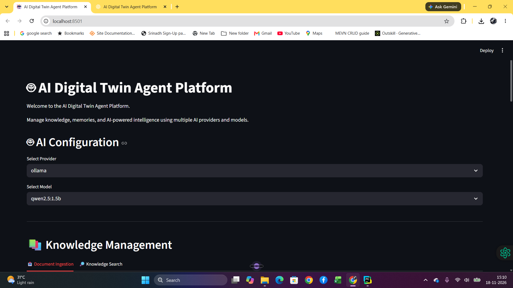

### 2. Knowledge Management

Upload documents in PDF, DOCX, TXT, Markdown, and CSV formats.

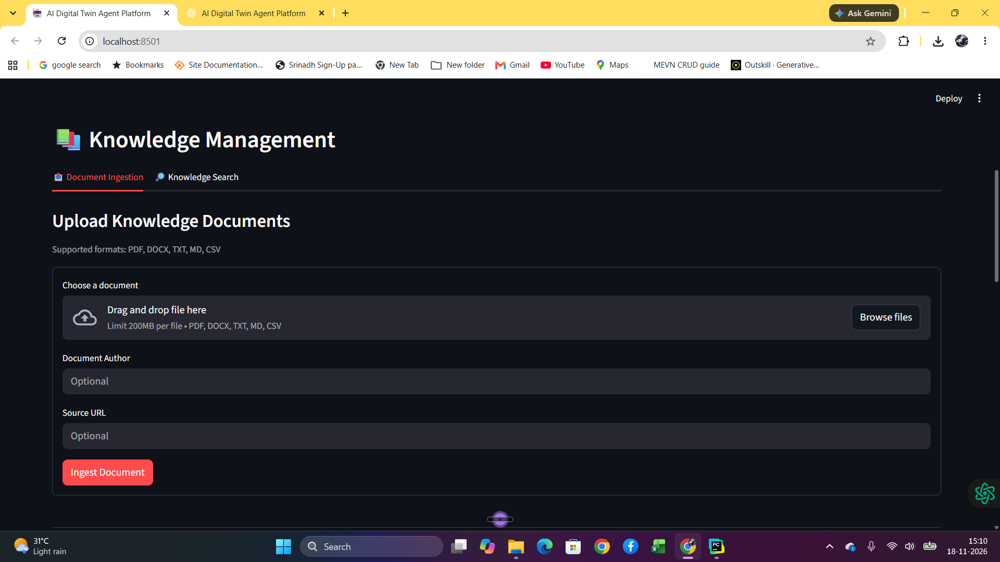

### 3. Knowledge Search

Search the ingested knowledge base.

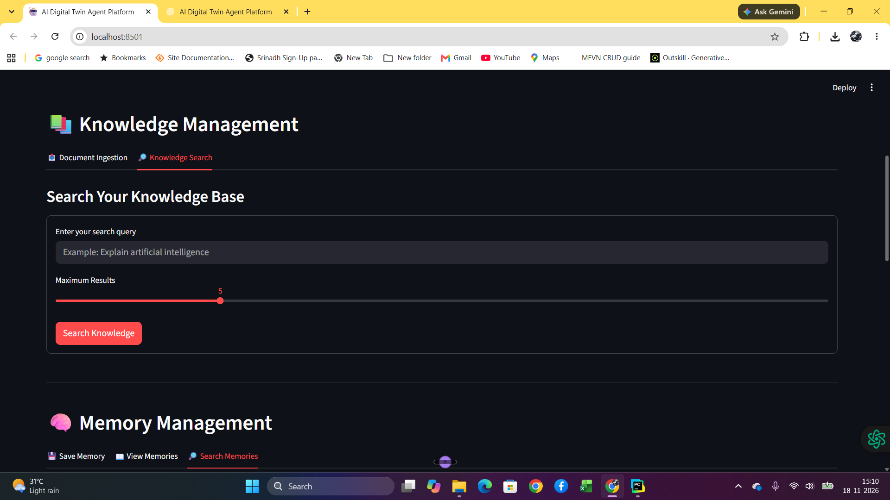

### 4. Memory Management

Create and save digital twin memories with different memory types.

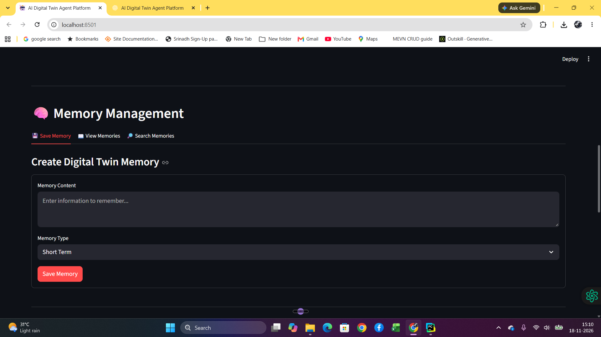

### 5. View Stored Memories

View saved memories and filter them by memory type.

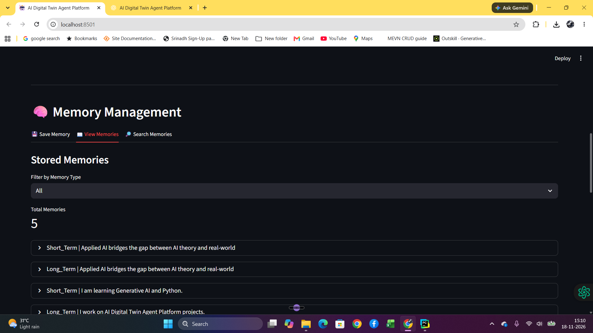

### 6. Search Memories

Search previously stored digital twin memories.

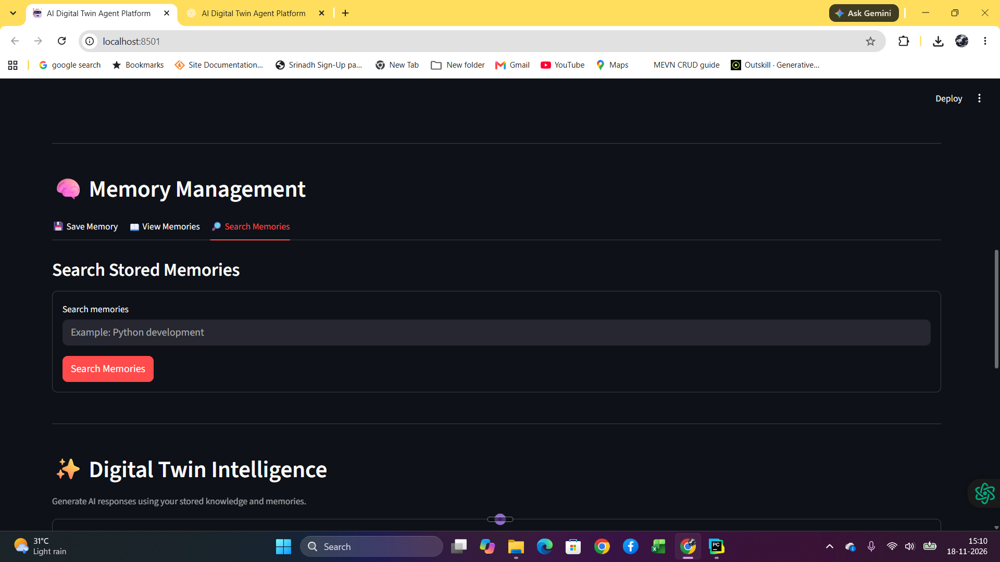

### 7. Digital Twin Intelligence

Generate AI responses using stored knowledge and memories.

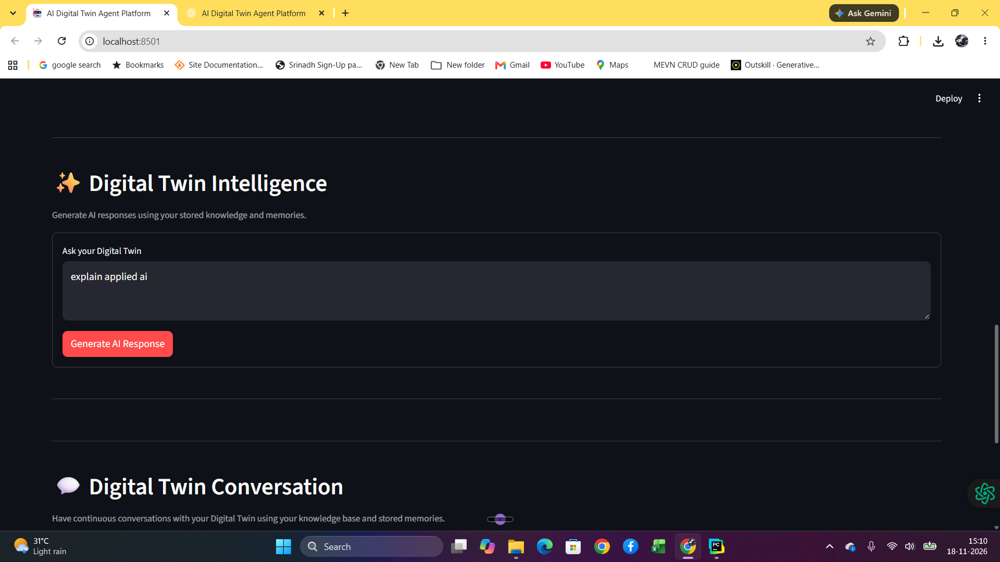

### 8. Digital Twin Conversation

Create and manage conversations with your digital twin.

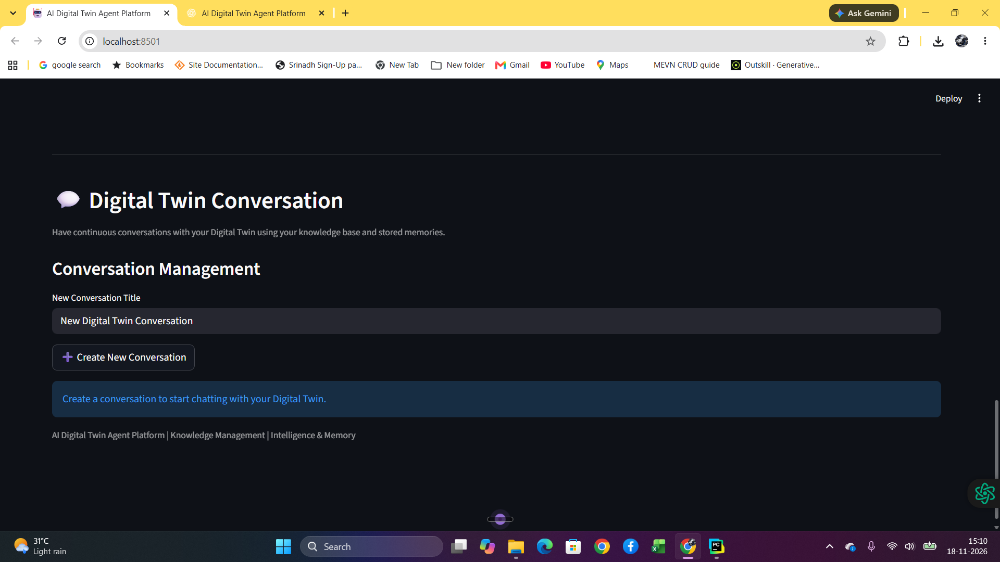

### 9. Create New Conversation

Start a new conversation with a custom conversation title.

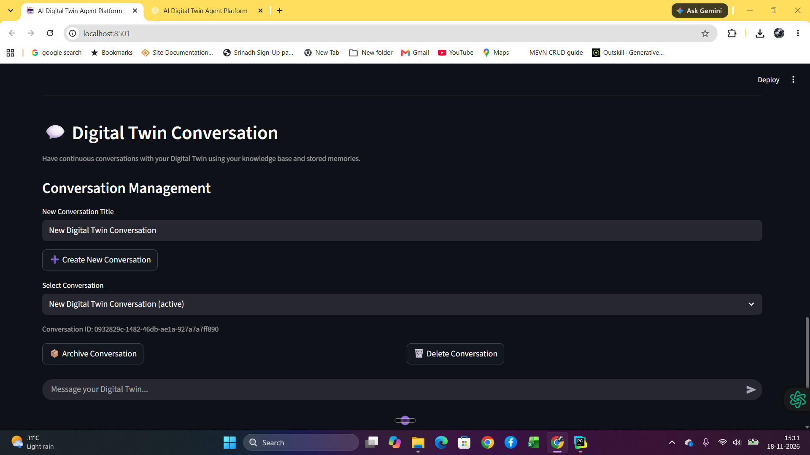

### 10. Chat History

View and manage conversation history, including archiving and deleting conversations.

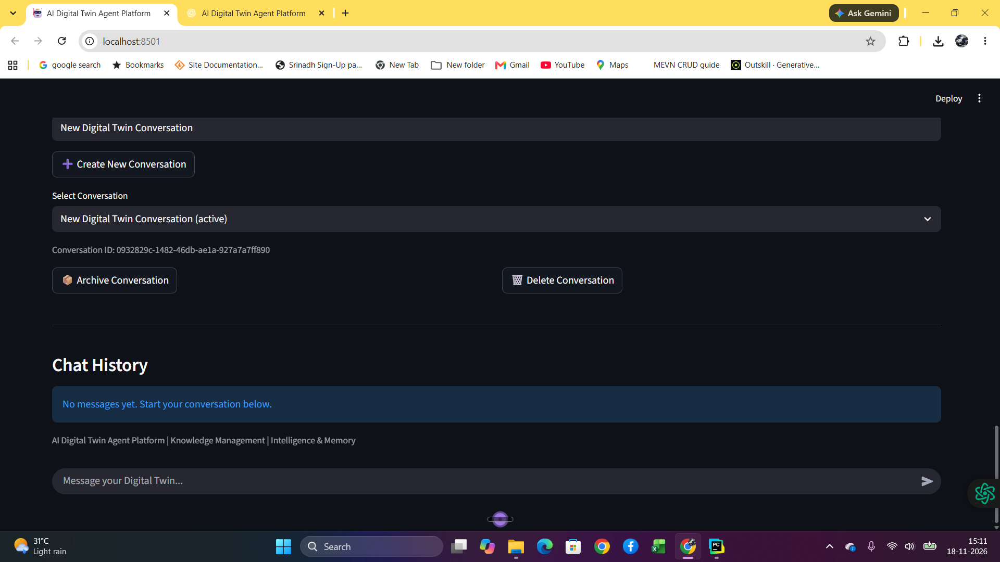

# 30. License and Author

**Project:** AI Digital Twin Agent Platform  
**Release:** v1.0.0  
**Author:** Project Developer

Add your selected open-source license before publishing or distributing the project.

---

<p align="center">
  <strong>AI Digital Twin Agent Platform</strong>
  <br/>
  Building an intelligent, context-aware and personalized digital representation.
</p>
