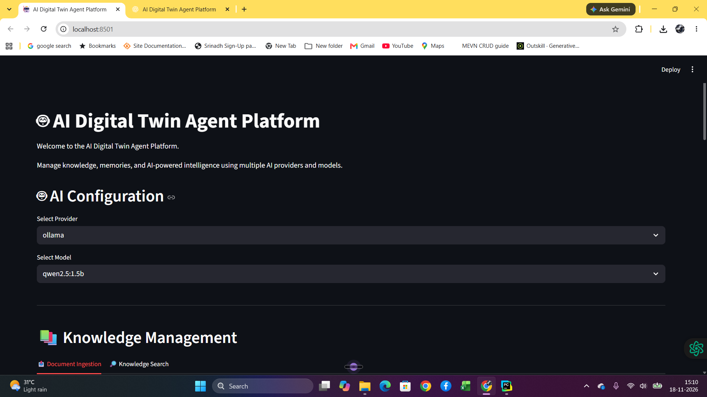
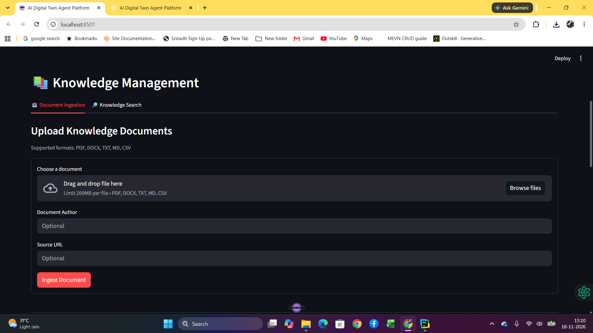
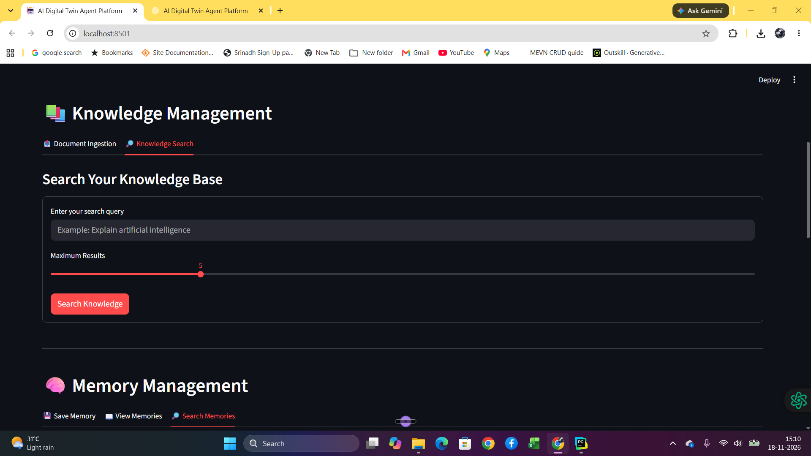
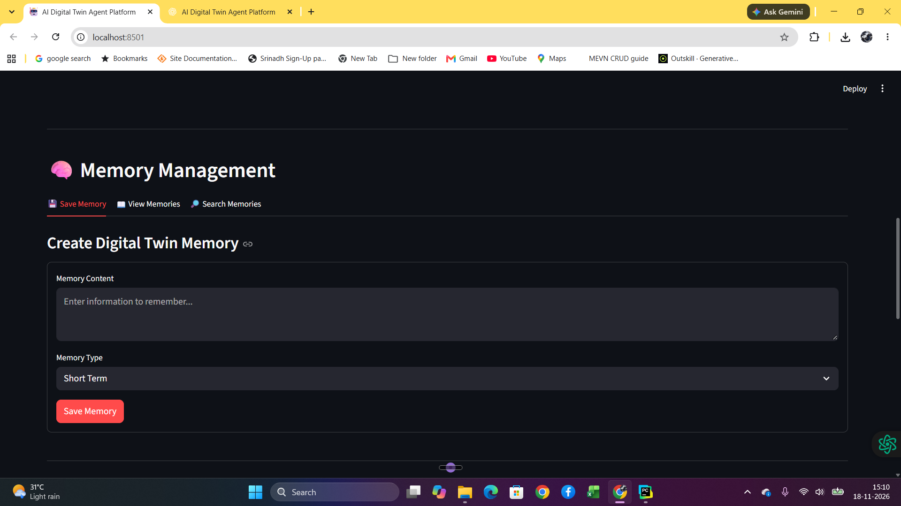
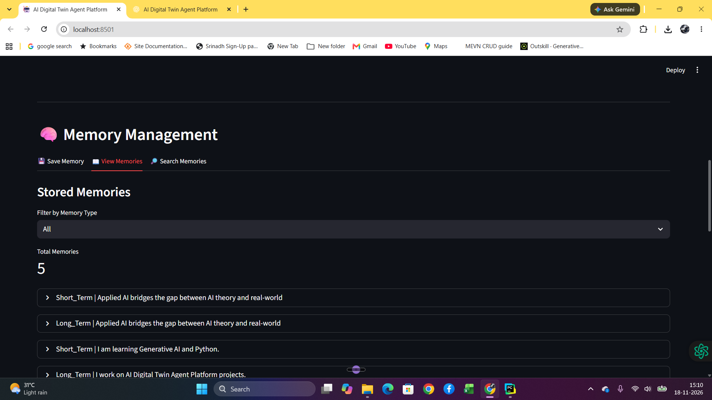
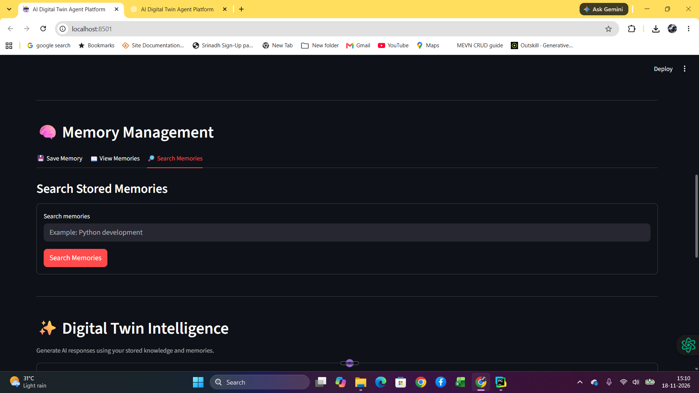
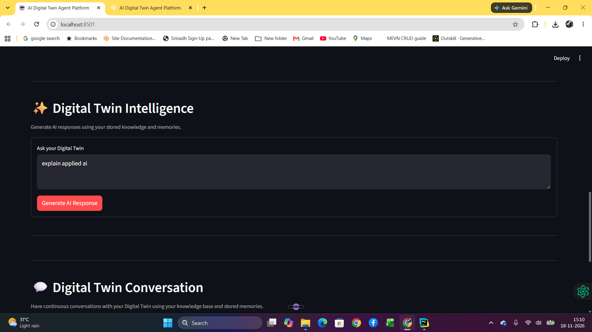
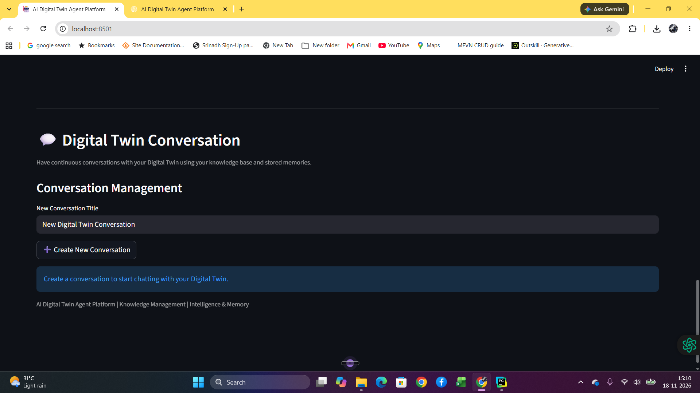
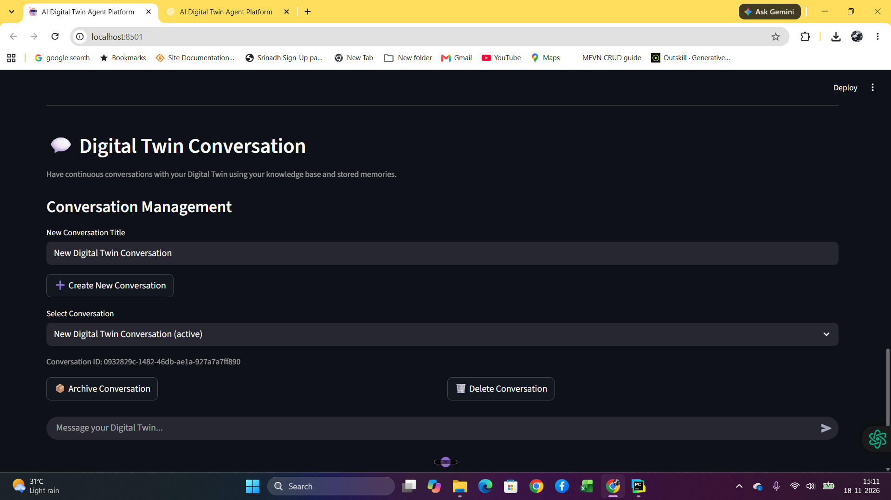
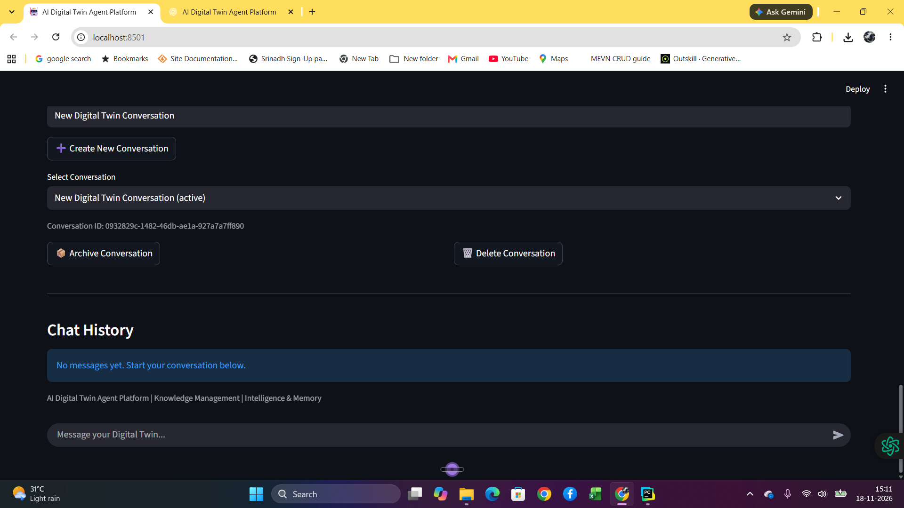

# 📸 Application Screenshots

## AI Digital Twin Agent Platform

This document showcases the user interface and major features of the AI Digital Twin Agent Platform.

All screenshots are stored in the project's `screenshots/` directory.

---

## 1. AI Provider and Model Configuration

Select an AI provider and its configured model.



**Highlights:**
- Multiple AI provider integrations.
- Provider selection.
- Model selection.
- Default Ollama model: `qwen2.5:1.5b`.

## 2. Knowledge Management – Document Ingestion

Upload documents to the knowledge base.



**Highlights:**
- PDF, DOCX, TXT, Markdown, and CSV support.
- Document author field.
- Source URL field.
- Document ingestion.

## 3. Knowledge Management – Knowledge Search

Search documents stored in the knowledge base.



**Highlights:**
- Search query input.
- Maximum result selection.
- Knowledge search functionality.

## 4. Memory Management – Save Memory

Create and save memories for the digital twin.



**Highlights:**
- Memory content input.
- Memory type selection.
- Save memory functionality.

## 5. Memory Management – View Memories

View stored memories and filter them by memory type.



**Highlights:**
- Stored memory listing.
- Memory type filtering.
- Total memory count.
- Expandable memory details.

## 6. Memory Management – Search Memories

Search previously stored memories.



**Highlights:**
- Memory search input.
- Search stored memories.

## 7. Digital Twin Intelligence

Generate AI responses using stored knowledge and memories.



**Highlights:**
- Ask questions to the digital twin.
- Generate AI responses.
- Use stored knowledge and memories as context.

## 8. Digital Twin Conversation

Manage continuous conversations with the digital twin.



**Highlights:**
- Create new conversations.
- Select existing conversations.
- Archive conversations.
- Delete conversations.

## 9. New Conversation Creation

Create a conversation using a custom title.



**Highlights:**
- Conversation title input.
- Create new conversation action.
- Conversation management.

## 10. Chat History

View and manage digital twin conversation history.



**Highlights:**
- Conversation history.
- Message display.
- Chat input.
- Continuous interaction with the digital twin.

---

## Screenshot Directory Structure

```text
AI-Digital-Twin-Agent-Platform/
│
├── screenshots/
│   ├── providers-models.png
│   ├── ingestion.png
│   ├── search.png
│   ├── memory.png
│   ├── viewmem.png
│   ├── searchmem.png
│   ├── digitaltwinintelligence.png
│   ├── digitaltwinconversations.png
│   ├── newconversationcreated.png
│   └── chathistory.png
│
└── docs/
    └── SCREENSHOTS.md
```

---

**Project:** AI Digital Twin Agent Platform  
**Version:** 1.0  
**Documentation:** Application Screenshots